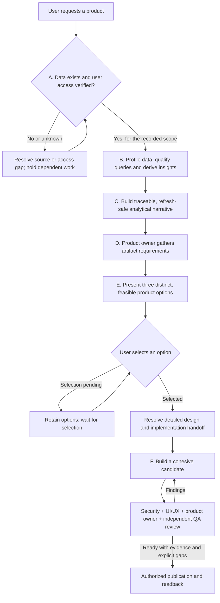

# Data-first product workflow

Use this sequence for a net-new analytical product or an explicitly commissioned
product reconception. It governs the order of work across the orchestrator and
direct specialist entrypoints. It supersedes generic advice to choose a design
direction directly or to add storytelling after screen design. A focused repair,
faithful migration or continuation of an already selected product reuses current
evidence and decisions; reopen only affected stages.

The sequence is **access → analysis → narrative → artifact discovery → three
options and user selection → detailed design → implementation and review**.
The order is fixed for this route; the visual result is not a fixed template.

## A. Establish data existence and user access

**Owner:** orchestrator with BI/access verification support. Recover the user's
decision, intended audience, requested source and target tenant. Ask only the
minimum needed to identify this scope; preserve volunteered design preferences
without starting the artifact interview.

Verify actual models, topics, fields and relevant records through permitted
read-only calls. Record the tenant, connection, source identities, observed query,
principal, intended user/audience, scope and observation time. A visible model name
does not prove query access; a successful administrator/service-account query does
not prove the user's access or the eventual audience's effective access. A valid
empty result is different from missing data, denied access and an unavailable tool.

**Exit:** source existence and the intended user's access are supported for the
recorded scope. Unknown or denied access holds dependent data analysis and product
design. Identify the exact missing evidence or access owner; never widen access,
silently switch sources or treat a local assertion as verification. A genuine
model gap can use the existing DMA handoff. Previously verified evidence may be
reused when its source and access context remain current.

## B. Understand the data before choosing the product

**Owners:** data analyst and BI engineer, coordinated by the accelerator. Profile
relevant available sources beyond the first convenient query: grain, relationships,
populations, history, coverage, units, missingness and meaningful comparison/detail.
Resolve metric definitions and build governed queries; inspect results and verify
important totals independently. Retain query identities/definitions, source scope,
filters, period, denominators and observed results in the private engagement.

**Exit:** a source-capability inventory, reusable query/metric contracts, supported
findings and a question map: what can be answered, what needs qualification, and
what the data cannot answer. Distinguish observations, inference and hypotheses.
No interesting finding is also a valid result; do not fabricate anomalies to earn
a visual treatment. Complete this analytical handoff before proposing layouts.

## C. Establish a reusable analytical narrative

**Owner:** data storyteller; analyst verifies meaning. Start with the decision and
verified analysis, before a screen/tile specification exists. Explain what users
can learn, which evidence supports it, what they can inspect next and what action
the evidence can inform. Do not equate narrative with decorative theme copy.

Use the existing claim ledger and versioned engagement evidence. Each consequential
claim or question links to its metric/query, source, grain, population, filters,
period/baseline and calculation. Specify when the claim is valid, reverses, becomes
inconclusive or must be withheld. Record refresh source/cadence, freshness rules,
late/partial/empty/denied states and the monitoring owner when known; keep unknowns
explicit. Snapshot evidence proves the current observation, while reusable rules
recompute or suppress claims as new data arrives. A refresh intention is not a
configured refresh job or working live connection.

**Exit:** a traceable narrative and question hierarchy with dynamic claim rules,
supported drill paths and monitoring needs. Have the analyst check it before the
artifact interview. Changes in definitions or data context reopen affected claims.

## D. Interview for the artifact using the analytical findings

**Owner:** product owner, with designer and branding consultation. Explain the
supported insights and questions, then ask a concise batch about audience tasks,
desired product/surface, experience ambition, first/repeat use, devices, branding,
interaction and delivery constraints. Recover existing answers instead of asking
again. When branding is wanted, obtain the company website and approved logo/asset
source or reuse existing authorization.

**Exit:** an evidence-informed product brief retaining the user's own requirements,
the analytical narrative and unresolved material choices. Agent proposals remain
proposals. The product owner returns the brief to the orchestrator; the user does
not have to coordinate individual specialists or prescribe CSS.

## E. Offer three products, select one, then resolve its design

**Owners:** app/dashboard designer, product owner, branding and relevant specialists.
Curate **exactly three materially different, feasible product options** using the
same core analytical narrative and truthful evidence. Differentiate the experience
structure, investigation path, focal visualization or interaction model, not just
colors or names. Each must honor the requested ambition; do not make two weak
options to steer the user toward a predetermined choice. Do not prescribe the same
three archetypes for every engagement.

For each option present:

- The intended user outcome and supported questions/insights.
- A concrete task or analytical reading path appropriate to the requested surface,
  with detail/return when useful, and a distinctive design idea. Identify which
  data relationships the visuals express; a native monitoring view need not invent
  App navigation.
- A comparable concept sketch/storyboard and representative content. Use permitted
  visual previews when available; source-only proposals are not rendered evidence.
- Relevant interactions, media/spatial possibilities, monitoring/export behavior,
  accessibility, feasibility, dependencies and maintenance tradeoffs.

Recommend an option with reasons, then **wait for the user's actual selection**.
A general request to build an app, an agent's `selected` field, silence or passing
checks cannot substitute for that selection. Reuse a selection already made for
the current options; a later explicit user instruction can change this process.
Preselection work is bounded concept/feasibility work, not a full product build.

After selection, resolve the complete design: app/dashboard architecture; background
and wallpaper; typography and imagery; buttons and controls; columns/splits, scroll
and page transitions; tabs/navigation; embedded artifacts; 3D models or custom
visuals/charts; exports; responsive behavior; UX, accessibility and motion states.
For each relevant capability record its purpose, bindings and fallback. Record
unselected/not-applicable treatments with rationale rather than installing every
feature. Preserve the selected ambition without inventing data or loading unapproved
dependencies. Review security and native feasibility before implementation depends
on a capability. Source/asset/permission limits remain binding.

**Exit:** an attributable user selection plus a resolved design and bounded build
handoff, including query/narrative/asset dependencies and observable acceptance
criteria. The selected design intent remains canonical; its North Star is derived.

## F. Implement cohesively and review every iteration

**Owner:** app/BI engineer; orchestrator integrates consultant feedback. Aim for one
coherent first implementation from the resolved handoff, rather than discovering
the product while coding. Bounded technical qualification or a representative
integration slice may reduce risk; neither replaces the selected experience nor
allows the delivered product to shrink to an elementary demo.

For **every candidate iteration**, obtain and consolidate four review perspectives:

| Consultant | Review responsibility |
| --- | --- |
| Security | Data/access boundaries, secrets, untrusted content, asset/dependency/resource policy, embeds, exports and external actions |
| UI/UX | Selected concept, art direction, visual/interaction craft, responsive behavior, accessibility and continuity across destinations |
| Product owner | Original user outcome, selected option, narrative coverage and any lost ambition or requirements |
| Independent QA | Query/metric correctness, dynamic claims, controls, state/recovery behavior, source parity where relevant and observed runtime evidence |

Use actual named consulting workers and explicit assignments. Reviews can share a
qualified independent worker or run sequentially under host limits; a list of role
names is not execution, and an implementer cannot supply independent review of its
own candidate. Record each perspective's findings separately against the exact
candidate. Use current execution roles and scoped review evidence; do not invent
new helper schema keys or claim a security certification from a bounded review.

Repair findings and review each revised candidate. Reassess affected behavior while
retaining valid prior evidence; do not rerun unrelated tests. CLI-only constraints
leave rendered/native observations unverified and do not justify generic design.
If fixes change the chosen concept or analytical meaning, return to the affected
earlier stage instead of silently substituting a new product. One-shot is a quality
target, not permission to skip feedback, fabricate passes or promise no iteration.

## Record continuity and limits honestly

Keep A–C evidence, option proposals and attributable selection in the existing
private engagement, outside the repository. Use source inventory, query contracts,
claim ledger, product notes and selected intent dependencies rather than a second
requirements ledger. Maintain the chain:

`access/source → query/analysis → narrative/claim → user requirement → option/selection → design → code → review`

Advance only when the stage's evidence is sufficient; continue unrelated work when
one branch is blocked. Use the [executable stage gates](stage-gates.md) before
dispatch, authoring and candidate review, alongside startup/ownership and delivery
checks. Supported entrypoints reject missing or stale predecessors and require a
trusted host verifier for the actual option choice. The stock CLI stops at choice;
no production host adapter is shipped. Local files cannot authenticate effective
access or certify design quality. Raw shell/file writes outside the package require
host enforcement; they are not constrained by a Python helper.

Omni CLI/MCP/API transports and executes supported operations. It is not an implicit
handoff to Omni AI/Blobby. Record whether any AI authoring endpoint was actually
used. Publication requires the existing authorization and readback workflow; a
concept choice does not authorize new sharing, package installation or deployment.
